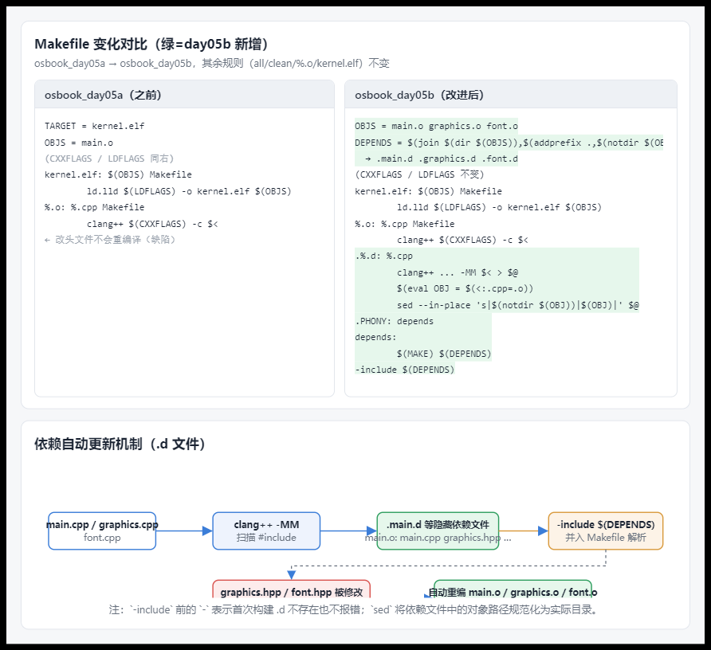

## MikanOS `osbook_day05b` 相对前序版本的改进（重点：Makefile）

`osbook_day05b` 对应《ゼロからのOS自作入門》第5章，这一章的核心主题就是**分割编译 + 依赖关系自动更新**。相比 `day05a`（以及更早的 `day04`），最关键的改进集中在 Makefile 上，有两层：**① 工程结构上把单文件拆成多文件；② Makefile 引入编译器生成的 `.d` 依赖文件，实现“改头文件也会自动重编译”**。

### 一、Makefile 逐行对比（day05a → day05b）

先看两版差异最直接的部分：

| 项 | `osbook_day05a` | `osbook_day05b` | 改进点 |
| --- | --- | --- | --- |
| 目标文件 | `OBJS = main.o`（单文件） | `OBJS = main.o graphics.o font.o` | 分割编译：`main.cpp` 被拆成 `graphics.cpp`(像素绘制/PixelWriter)、`font.cpp`(字体/WriteAscii)，并配套 `graphics.hpp`、`font.hpp` |
| 编译/链接参数 | `CXXFLAGS`、`LDFLAGS` | 完全相同 | 无变化，改进不在参数 |
| 依赖文件变量 | 无 | `DEPENDS = $(join $(dir $(OBJS)),$(addprefix .,$(notdir $(OBJS:.o=.d))))` | 用 make 内置函数批量生成“隐藏依赖文件”名 `.main.d .graphics.d .font.d` |
| 依赖生成规则 | 无 | `.%.d: %.cpp` + `clang++ -MM` | 由编译器自动扫描 `#include` 生成依赖清单 |
| 依赖引入 | 无 | `-include $(DEPENDS)` | 把依赖文件并入 Makefile |
| 手动重建目标 | 无 | `.PHONY: depends` | 提供强制重新生成依赖的入口 |

**day05b 新增的核心规则**（其余 `all`/`clean`/`%.o`/`kernel.elf` 规则与之前一致）：

```
.%.d: %.cpp
	clang++ $(CPPFLAGS) $(CXXFLAGS) -MM $< > $@    # ① 扫描头文件依赖，写入隐藏文件 .%.d
	$(eval OBJ = $(<:.cpp=.o))                      # ② 由源码反推出对应目标文件路径
	sed --in-place 's|$(notdir $(OBJ))|$(OBJ)|' $@   # ③ 把 .d 里的对象名规范化成实际路径

.PHONY: depends
depends:
	$(MAKE) $(DEPENDS)                              # 手动强制重建所有 .d

-include $(DEPENDS)                                 # 解析时自动并入依赖文件（- 表示首次缺失不报错）
```

### 二、为什么要这么改：day05a 的致命缺陷

在 `day05a`（及之前），规则是 `%.o: %.cpp Makefile`，即**每个 `.o` 只依赖自己的 `.cpp` 和 Makefile**。一旦 `graphics.hpp`、`font.hpp` 这类头文件被修改，make 认为没有任何目标“过期”，于是**不重新编译**——但 `.cpp` 里 `#include` 了这些头文件，代码逻辑已经变了，产物却是旧的，产生难以排查的“陈旧对象”问题。

day05b 用编译器的 `-MM` 扫描真实 `#include` 关系，把 `main.o: main.cpp graphics.hpp font.hpp ...` 这样的依赖写进 `.d` 文件并 `-include` 进 Makefile，从此**头文件一改，所有依赖它的 `.o` 都会自动重建**。这正是第5章“依赖关系自动更新”要解决的问题。

### 三、`.d` 文件机制原理

```
main.cpp ──clang++ -MM──▶ .main.d （隐藏文件）──sed 规范化──▶ -include 并入 Makefile
                                                            │
头文件 graphics.hpp / font.hpp 被修改 ────────────────▶ make 判定依赖过期 ▶ 重编 main.o
```

依赖文件用 `.xxx.d` 的**隐藏文件**命名，避免污染源码目录；`-include` 前的 `-` 号保证首次构建时 `.d` 不存在也不报错；`sed` 那步是为了让依赖文件里的对象路径与真实目录一致（day05b 中对象都在当前目录，等效无操作，但使写法对子目录工程也通用）。

### 四、后续版本的一点点延伸（供参考）

- `osbook_day05c`：加入 `hankaku.o`（由 `hankaku.txt` 经 `makefont.py` + `objcopy` 生成的二进制字体）及 `.%.d: %.bin` 的 touch 规则。
- `osbook_day05d`：新增 `newlib_support.o`（`.c` 文件），补充 `%.o: %.c` 规则、`CFLAGS`，并在链接加 `-lc`。

下面把两版 Makefile 的差异和依赖机制画成一张图：



**一句话总结**：day05b 的两处本质改进都在 Makefile —— 一是把单文件拆成多文件用 `OBJS` 多目标链接（分割编译），二是用 `clang++ -MM` + `-include` 自动生成并纳入头文件依赖（依赖自动更新），解决了改头文件不会触发重编译的陈旧对象问题；编译与链接参数本身没有变化。